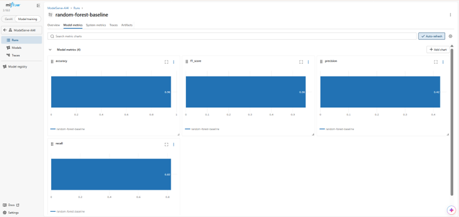
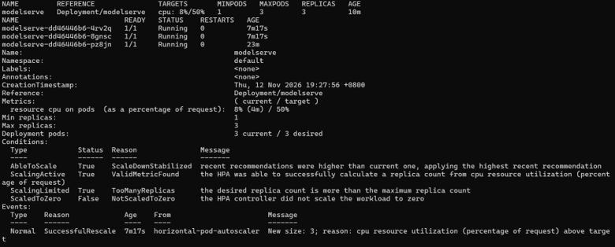

# MLOps Lab 1 - Model Service on Kubernetes


*A Cloud-Native Machine Learning Inference Pipeline*

**A Lightweight Cloud-Native ML Serving & Experiment Tracking Platform**

Python | Scikit-learn | MLflow | FastAPI | Docker | Kubernetes | HPA

## Overview

This Lab 1 project is a lightweight machine learning serving pipeline that combines model training, experiment tracking, containerized inference, and Kubernetes autoscaling.

The implementation uses the AI4I 2020 Predictive Maintenance Dataset to demonstrate binary machine-failure classification in a simulated manufacturing context.

The project focuses on a minimal, reproducible local MLOps workflow.

## Architecture

```text
AI4I 2020 Dataset
        |
        v
Scikit-learn Training
        |
        +----> MLflow Experiment Tracking
        |
        v
Saved Model (joblib)
        |
        v
FastAPI Inference
        |
        v
Docker Container
        |
        v
Kubernetes Deployment & Service
        |
        v
Horizontal Pod Autoscaler
```

## Dataset and Model

**Dataset:** AI4I 2020 Predictive Maintenance
**Source:** UCI Machine Learning Repository
**Observations:** 10,000 (synthetic)
**Algorithm:** Random Forest Classifier
**Task:** Binary classification

### Input Features

- Product type (L, M, H)
- Air temperature (K)
- Process temperature (K)
- Rotational speed (rpm)
- Torque (Nm)
- Tool wear (minutes)

**Target:** Machine failure (0 or 1)

Failure-mode labels and record identifiers are excluded from the model inputs.

### Evaluation Results

| Metric | Value |
|---|---:|
| Accuracy | 0.9560 |
| Precision | 0.4242 |
| Recall | 0.8235 |
| F1-score | 0.5600 |

Evaluation uses a stratified 80/20 train-test split with random seed 42.

These results describe performance on a held-out subset of synthetic data, not real-world industrial reliability.

## Local Setup

Requires Python 3.12.

Create a virtual environment:

```powershell
py -3.12 -m venv .venv
```

Install dependencies:

```powershell
.\.venv\Scripts\python.exe -m pip install -r requirements-training.txt
.\.venv\Scripts\python.exe -m pip install -r requirements-serving.txt
```

## Model Training

Download the AI4I 2020 dataset:

```powershell
.\.venv\Scripts\python.exe fetch_data.py
```

Train the model:

```powershell
.\.venv\Scripts\python.exe train.py
```

The training pipeline saves the inference artifact to `model/model.joblib` and logs experiment parameters, metrics, and model artifacts to MLflow.

## MLflow Experiment Tracking

This project uses MLflow with a local SQLite backend for experiment tracking.

Run training commands and the MLflow server from the repository root so both use the same `mlflow.db` database.

Start the MLflow server:

```powershell
.\.venv\Scripts\mlflow.exe server --backend-store-uri sqlite:///mlflow.db --host 127.0.0.1 --port 5000
```

Open the dashboard:

http://127.0.0.1:5000

Experiment name: `ModelServe-AI4I`

## FastAPI Inference

Start the API:

```powershell
.\.venv\Scripts\python.exe -m uvicorn app:app --host 127.0.0.1 --port 8000
```

Available endpoints:

- `GET /health` — Service health check
- `POST /predict` — Machine-failure classification

Interactive API documentation:

http://127.0.0.1:8000/docs

### Example Request

```json
{
  "type": "L",
  "air_temperature": 300.0,
  "process_temperature": 310.0,
  "rotational_speed": 1500,
  "torque": 40.0,
  "tool_wear": 100
}
```

Verified response:

```json
{
  "machine_failure": 0
}
```

## Docker

Build the inference image:

```powershell
docker build -t modelserve:0.1.0 .
```

Run the container:

```powershell
docker run --rm -p 8001:8000 modelserve:0.1.0
```

The container serves the trained model using FastAPI.

## Kubernetes Deployment

Create a local Kubernetes cluster:

```powershell
kind create cluster --name modelserve
```

Load the Docker image into kind:

```powershell
kind load docker-image modelserve:0.1.0 --name modelserve
```

Deploy the application:

```powershell
kubectl --context kind-modelserve apply -f k8s/deployment.yaml
kubectl --context kind-modelserve apply -f k8s/service.yaml
```

Verify the deployment:

```powershell
kubectl --context kind-modelserve get pods
kubectl --context kind-modelserve get deployments
kubectl --context kind-modelserve get services
```

To access the Kubernetes-hosted API:

```powershell
kubectl --context kind-modelserve port-forward service/modelserve 8002:8000
```

API documentation:

http://127.0.0.1:8002/docs

## Horizontal Pod Autoscaling

The implementation uses Kubernetes HPA with CPU utilization metrics.

### Configuration

| Parameter | Value |
|---|---|
| Minimum replicas | 1 |
| Maximum replicas | 3 |
| CPU utilization target | 50% |
| Container CPU request | 50m |
| Container CPU limit | 500m |

CPU-based autoscaling requires Kubernetes Metrics Server.

For the local kind environment, Metrics Server was installed using its official manifest. The `--kubelet-insecure-tls` option was enabled for local testing only.

Apply the HPA after Metrics Server becomes available:

```powershell
kubectl --context kind-modelserve apply -f k8s/hpa.yaml
```

Monitor autoscaling:

```powershell
kubectl --context kind-modelserve get hpa
kubectl --context kind-modelserve get pods
kubectl --context kind-modelserve top pods
```

## Autoscaling Verification

Concurrent HTTP inference requests were generated using `hey`.

### Observed Results

- Initial replica count: 1
- Peak observed CPU utilization: 678% of requested CPU
- HPA event: `SuccessfulRescale`
- Desired replica count increased to 3
- All three replicas subsequently reached `Running` and `Ready`
- No pod restarts were reported during the final verification

The test confirms CPU-triggered HPA scale-out in a local Kubernetes environment.

Because the load was sent through `kubectl port-forward`, this experiment does not establish load balancing or traffic distribution across the replicas.

## Reproducing the HPA Experiment

The following procedure is intended for a **fresh, local kind cluster** after completing the Docker build and Kubernetes Deployment/Service steps above. It documents an example reproducible procedure, **not an assertion that the original experiment used these exact Metrics Server release or `hey` flags**. Commands are written for Windows PowerShell.

### 1. Install Metrics Server for local kind

CPU-based HPA requires the Kubernetes resource metrics API. The following example pins Metrics Server to v0.9.1 (compatible with Kubernetes 1.34+; verify compatibility if using another cluster version) rather than an ever-changing `latest` URL:

```powershell
kubectl --context kind-modelserve apply -f https://github.com/kubernetes-sigs/metrics-server/releases/download/v0.9.1/components.yaml
```

For **local kind testing only**, if its kubelet certificate cannot be verified, append `--kubelet-insecure-tls` to the Metrics Server container arguments. Using `--patch-file` avoids PowerShell native-command JSON quoting problems:

```powershell
$patchPath = Join-Path $env:TEMP 'macline-kind-metrics-patch.json'
'[{"op":"add","path":"/spec/template/spec/containers/0/args/-","value":"--kubelet-insecure-tls"}]' | Set-Content -Path $patchPath -Encoding ASCII
kubectl --context kind-modelserve -n kube-system patch deployment metrics-server --type=json --patch-file $patchPath
kubectl --context kind-modelserve -n kube-system rollout status deployment/metrics-server --timeout=180s
kubectl --context kind-modelserve get apiservice v1beta1.metrics.k8s.io
kubectl --context kind-modelserve top nodes
```

**Security note:** `--kubelet-insecure-tls` disables certificate validation. Do not use this setting for production clusters. Apply the patch only once, when needed; repeated JSON `add` operations can duplicate the argument.

After Metrics Server becomes available, enable and inspect HPA:

```powershell
kubectl --context kind-modelserve apply -f k8s/hpa.yaml
kubectl --context kind-modelserve get hpa
kubectl --context kind-modelserve get pods
```

### 2. Generate inference load

Keep the Kubernetes service port-forward running **in its own terminal**:

```powershell
kubectl --context kind-modelserve port-forward service/modelserve 8002:8000
```

In another PowerShell terminal, create a sample JSON request file and use [`hey`](https://github.com/rakyll/hey) to send concurrent `POST /predict` requests:

```powershell
$bodyPath = Join-Path $env:TEMP 'macline-load.json'
'{"type":"L","air_temperature":300.0,"process_temperature":310.0,"rotational_speed":1500,"torque":40.0,"tool_wear":100}' | Set-Content -Path $bodyPath -Encoding ASCII
hey -z 3m -c 30 -m POST -T application/json -D $bodyPath http://127.0.0.1:8002/predict
```

The sample sends concurrent predictions for up to three minutes. The `-D` flag reads the request body from a file, avoiding Windows PowerShell quoting issues. Confirm that `hey` is installed and accessible on `PATH` before running.

### 3. Observe autoscaling

Monitor HPA and pods from another terminal:

```powershell
kubectl --context kind-modelserve get hpa -w
```

When finished, stop the watch and inspect the final state and events:

```powershell
kubectl --context kind-modelserve get pods
kubectl --context kind-modelserve describe hpa
kubectl --context kind-modelserve get events --sort-by=.lastTimestamp
```

**Interpretation:** CPU utilization is relative to the container CPU request (50m), not a percentage of total machine CPU. Scale-out may differ according to local CPU capacity, readiness, metrics availability, and HPA timing. Scale-down may take additional time. `kubectl port-forward` does not demonstrate load balancing across replicas. See *Observed Results* above for the measurements from the original local experiment.

**Sources:** [Metrics Server installation and compatibility](https://github.com/kubernetes-sigs/metrics-server#installation), [Kubernetes HPA behavior](https://kubernetes.io/docs/concepts/workloads/autoscaling/horizontal-pod-autoscale/), and [`hey` options](https://github.com/rakyll/hey#usage).

## Evidence

### MLflow Experiment



### Kubernetes HPA Scaling



Additional evidence:

- `screenshots/hpa_events.txt`
- `screenshots/kubernetes_pods.txt`

## Project Structure

```text
modelserve-cloud-native-ml/
├── README.md
├── app.py
├── fetch_data.py
├── train.py
├── Dockerfile
├── requirements-training.txt
├── requirements-serving.txt
├── model/
│   └── model.joblib
├── k8s/
│   ├── deployment.yaml
│   ├── service.yaml
│   └── hpa.yaml
└── screenshots/
    ├── mlflow_run.png
    ├── hpa_scaling.png
    ├── hpa_events.txt
    └── kubernetes_pods.txt
```

## Dataset Attribution

**AI4I 2020 Predictive Maintenance Dataset**

UCI Machine Learning Repository.

DOI: https://doi.org/10.24432/C5HS5C

License: Creative Commons Attribution 4.0 (CC BY 4.0).

The dataset is synthetic and represents simulated industrial operating conditions.

## Limitations

This repository is a local MLOps reference implementation.

The classification model was evaluated using synthetic data and has not been validated on physical industrial equipment.

The Kubernetes experiment demonstrates local CPU-based autoscaling, not production-scale deployment performance.

The implementation is intended to demonstrate a compact and reproducible machine learning serving workflow.


## License and Attribution

Original MAC-LINE source code and documentation are released
under the [MIT License](LICENSE).

Copyright (c) 2026 Muhamad Galuh Nugraha.

**Dataset:** The AI4I 2020 Predictive Maintenance Dataset is
synthetic and separately licensed under CC BY 4.0.
Source: UCI Machine Learning Repository.
DOI: https://doi.org/10.24432/C5HS5C

**Branding:** The MAC-LINE name and logo are project branding
assets, separate from the source-code MIT license.
Their use must not imply endorsement by the maintainer.

**Dependencies:** Third-party software retains its respective
licenses and copyright notices.